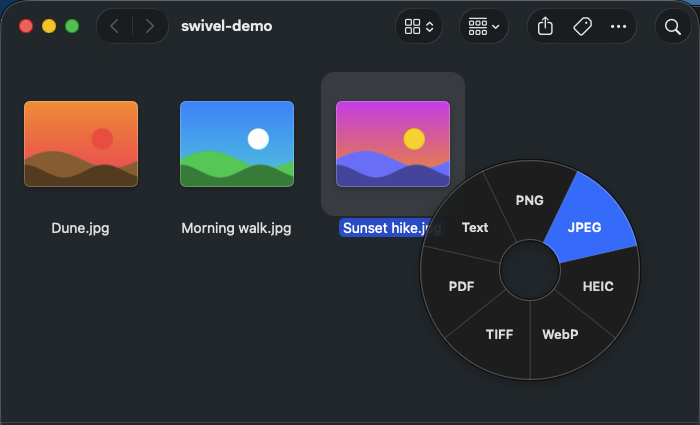

<div align="center">


# Swivel

**Drag. Tap Shift. Drop on a format.**

A Mac menu-bar file converter. Start dragging a file, tap a modifier key, and a wheel of formats opens under the pointer. Drop on one and the converted file lands next to the original. Nothing is uploaded.

[**Install**](#install) · [**How it works**](#how-it-works) · [**Case study**](#the-brief) · [**Build it**](#build-it)




</div>

|                 |                                                                                                   |
| --------------- | ------------------------------------------------------------------------------------------------- |
| **Role**        | Product, interaction design, macOS build, testing                                                 |
| **Stack**       | Swift package, SwiftUI + AppKit, ImageIO, PDFKit, Vision, AVFoundation, libwebp. No Xcode project. |
| **Inspired by** | [Tangerine](https://tangerineformac.com), a drag-to-convert Mac app (a clean-room rebuild, no code or assets reused) |
| **Converts**    | Images, PDFs, text from scans, audio and video                                                    |

### Contents

[The brief](#the-brief) · [How it works](#how-it-works) · [Design decisions](#design-decisions) · [Build](#build) · [How I checked it](#how-i-checked-it) · [What I'd do next](#what-id-do-next) · [Install](#install) · [Using Swivel](#using-swivel) · [Build it](#build-it)

---

## The brief

Converting a file on a Mac usually means opening it in Preview, finding Export, picking a format and a folder. Tangerine showed a faster way: the file is already in your hand while you drag it, so let the drag itself pick the format. I wanted my own version that I could understand end to end, built only on what macOS already ships, and a bit kinder about the details: settings for the wheel, an honest progress line, and an optional move to the Trash that never throws away a file it didn't fully convert.

## How it works

1. Start dragging a file from Finder.
2. Tap Shift or Control. A wheel opens under the pointer, with slices for that kind of file: images get PNG, JPEG, HEIC, WebP, TIFF, PDF and Text; video gets MP4, HEVC, MOV, GIF, M4A and WAV; audio gets M4A and WAV.
3. Drop on a slice. The new file appears next to the source as `name.ext`, then `name 2.ext`, and never overwrites anything.

There's also a no-drag mode: select files in Finder and tap Shift on its own, then click a slice. The menu-bar icon shows progress, the last result, Reveal in Finder and Cancel.

## Design decisions

- **No Accessibility permission.** Swivel watches the drag pasteboard and polls the modifier keys instead of installing an event tap. The only permission it asks for is Automation access to Finder, and only for the no-drag mode.
- **A tap, not a hold.** A key already held when the drag started (Shift from a multi-select, say) doesn't count. Only a fresh press opens the wheel, so the wheel never pops up by accident.
- **One wheel per kind of file.** Labels follow the file: an `.m4a` dropped on M4A says "Convert", a movie says "Extract audio". You can reorder or hide slices per kind in Settings.
- **System frameworks first.** ImageIO for images, PDFKit for PDFs, Vision for text recognition, AVFoundation for audio and video. The only bundled library is libwebp, because macOS can read WebP but can't write it. That also sets the limits: no MKV or WebM input and no MP3 output.
- **Trash only what was fully converted.** With *Move original to Trash* on, a source goes to the Trash only when every page, frame, track and channel made it into the output. Extractions (Text, GIF, audio from video) and anything partial keep the original, and the menu line says how many files stayed.

## Build

Swivel is a Swift package with two targets: `SwivelCore`, the converters and the pure logic (wheel geometry, trigger rules, what may be trashed), and `Swivel`, the menu-bar app. That split keeps almost all the behaviour testable without a running app. I built it in six milestones, each with a short design note in [`docs/designs/`](docs/designs):

| Milestone | What it added |
| --------- | ------------- |
| M1 | The gesture: drag detection, the modifier tap and the radial wheel |
| M2 | Image conversion, plus the no-drag Finder tap |
| M3 | PDFs (images to one PDF, pages to images) and text from scans or PDFs |
| M4 | Audio and video, with progress and Cancel |
| M5 | Settings (wheel layouts, quality) and Open at Login |
| M6 | Move original to Trash, and a choice of trigger key |

## How I checked it

- **300 unit tests** for the converters, geometry, trigger rules, settings parsing and the trash rules, including hostile input: junk settings, broken PDFs, 384 kHz audio, files that vanish mid-batch.
- **113 scripted QA checks** (`scripts/qa.sh`) that run real drops through the built app on throwaway disk images, including a read-only volume and one with no usable Trash.
- **UI rows driven for real** with synthetic mouse and key events and the accessibility tree: the wheel, the Finder tap, Settings, and VoiceOver's spoken output read back from its caption panel.
- Every milestone went through a separate code review and security review before it merged. Each "doesn't happen" check also had a matching "does happen" check.

## What I'd do next

- A signed and notarized release, so it opens without the Gatekeeper prompt.
- Keyboard control of the wheel (arrows and Return).
- More inputs through AVFoundation where macOS can decode them, and an MP3 encoder if I ever bundle one.

## Install

Swivel needs macOS 14 or later on Apple Silicon.

1. Download `Swivel-1.0.0.zip` from [Releases](https://github.com/Zubair-Elliot-17/swivel/releases) and double-click it to unzip.
2. Drag **Swivel** into your **Applications** folder. Do this before you open it.
3. Double-click Swivel in Applications. macOS says it can't verify the app, because Swivel isn't notarized by Apple (that needs a paid developer account). Click **Done**.
4. Open **System Settings > Privacy & Security**, scroll to **Security**, and click **Open Anyway** next to "Swivel was blocked". Confirm with your password, then click **Open Anyway** again. The button only shows for about an hour after step 3.

You only do this once. Swivel lives in the menu bar (look for its icon top right) and has no Dock icon. A welcome window shows the gesture; open it again from the menu with **Welcome…**.

**Terminal alternative** (skips steps 3-4; only for builds you downloaded from this repo's Releases page):

```sh
xattr -dr com.apple.quarantine /Applications/Swivel.app
```

**Updating:** quit Swivel, replace the app in Applications, and repeat steps 3-4 if macOS asks. Your Finder access and Open at Login carry over.

To build it yourself, see [Build it](#build-it).

## Using Swivel

### Triggers

- **During a drag:** start dragging a file from Finder, then tap Shift or Ctrl (or only the one chosen under Settings > General). The wheel opens under the pointer; drop on a format.
- **No drag, in Finder:** select files in a Finder window or on the Desktop, then tap Shift or Ctrl on its own. The wheel opens at the pointer; click a format. Click outside, tap again or switch apps to dismiss.

The no-drag mode reads the Finder selection through Apple events, so it needs Automation access to Finder. Choose **Enable tap in Finder…** in the menu-bar menu once and click Allow. If you chose Don't Allow, the item opens System Settings > Privacy & Security > Automation instead.

### Settings

Choose **Settings…** in the menu-bar menu (⌘, also opens it once Swivel is the active app; ⌘W closes it).

- **Move original to Trash** (default off): after a drop, each source that was fully converted goes to the Trash, so you can put it back from there. Extract text, Make GIF and Extract audio always keep the original. So does a partial conversion: a multi-page TIFF or animated GIF (only the first frame is converted), a PDF cut by the 100-page or pixel cap, or audio or video that lost a track, channels or sample rate (say 5.1 to WAV). A source is also kept when the batch was cancelled, when another drop still uses it, or when one of its outputs is missing. On volumes without a Trash (some network shares), or for a locked file, the file stays and the menu line ends with "(N not moved to Trash)". Known limit: subtitle, chapter, timecode and metadata tracks (such as iPhone location) aren't checked, so with this on, keep a copy of a movie that has them.
- **Open the wheel with:** Shift, Control, or Shift or Control (default). It applies to the drag wheel and the Finder tap. With one key chosen, the other does nothing.
- **Wheel layouts:** Images, Video and Audio each list their slices. Drag rows to reorder, switch a row off to hide it (one always stays on), or press **Reset**.
- **Quality:** one slider (50-100%, default 85%) for JPEG and HEIC output, including PDF pages saved as JPEG or HEIC. HEIC tops out at 99%. PNG, TIFF and WebP ignore it.

### Open at Login

**Open at Login** in the menu-bar menu registers Swivel as a login item; the check mark is re-read every time the menu opens. If you switch Swivel off under System Settings > General > Login Items, the item shows unchecked and clicking it opens that pane. Run Swivel from one place (for example `/Applications`), since the login item launches the copy that last registered.

## Build it

Needs macOS 14 or later and the Xcode Command Line Tools.

```sh
git clone https://github.com/Zubair-Elliot-17/swivel.git
cd swivel
scripts/dev-cert.sh            # once: a local signing identity, so permissions survive rebuilds
scripts/bundle.sh && open build/Swivel.app
```

Tests, scripted QA and how settings are stored: [docs/development.md](docs/development.md).
